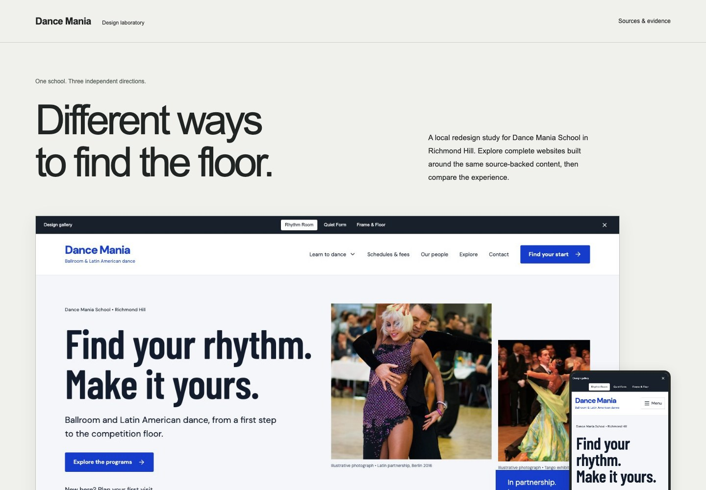
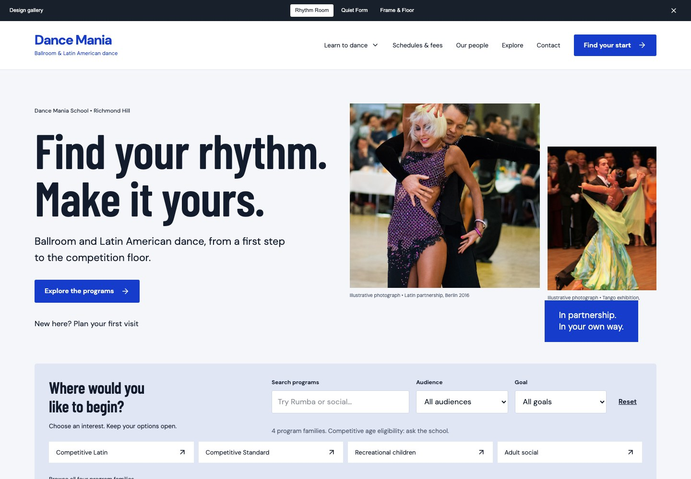
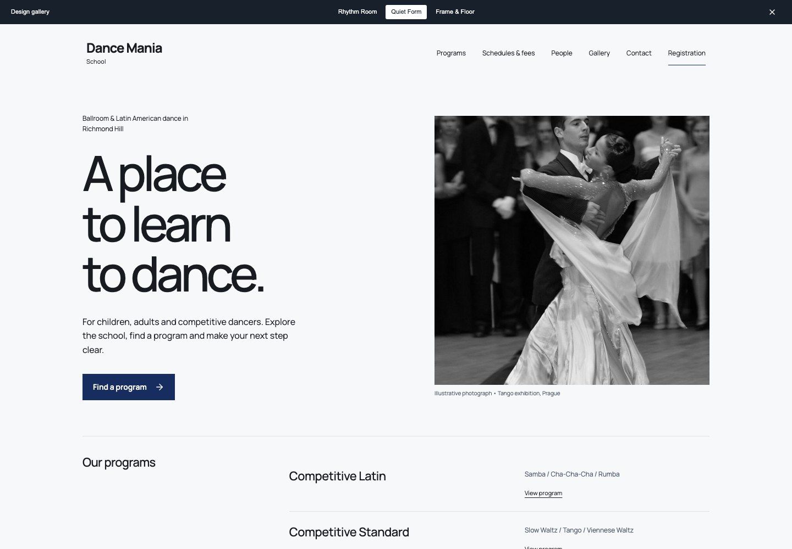
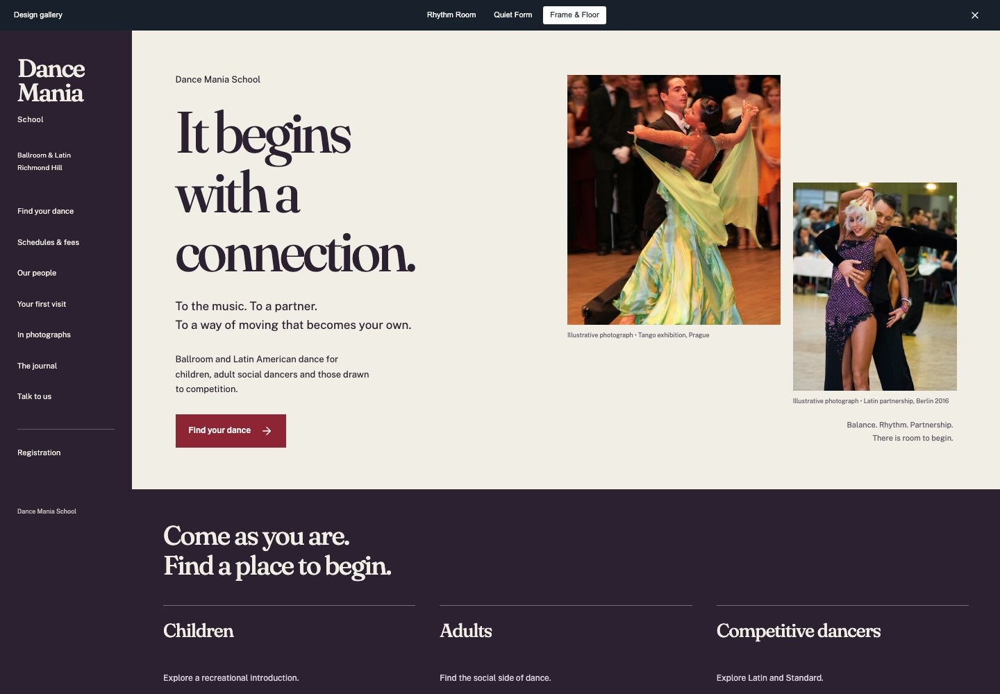
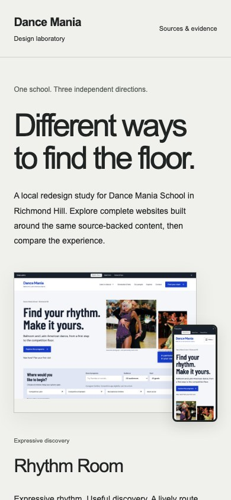
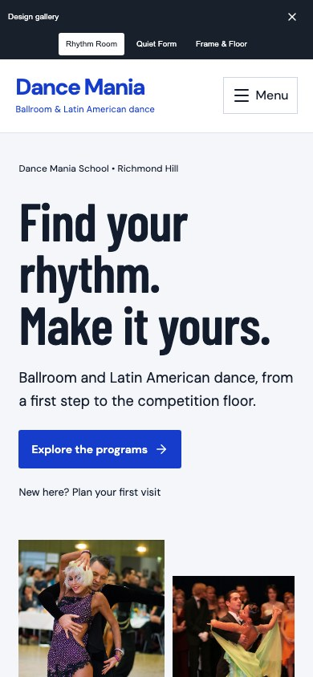
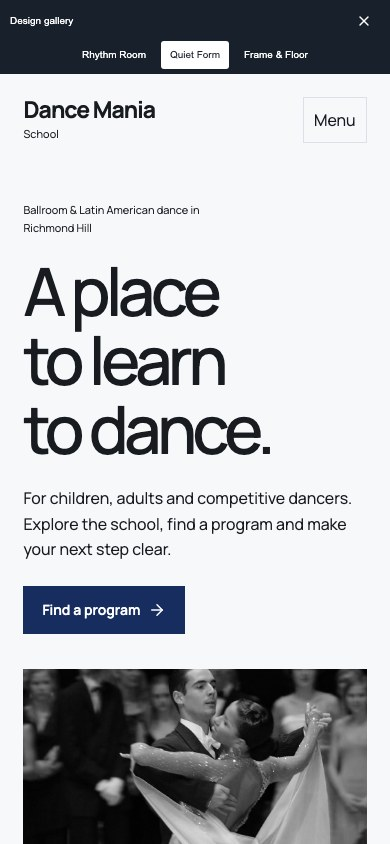
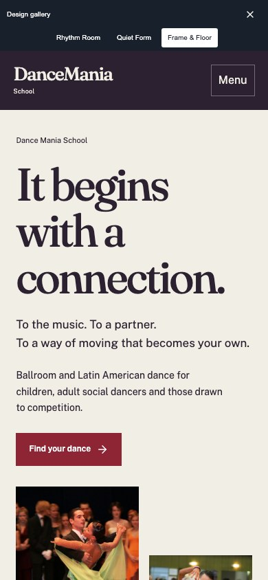

# Forensic execution report — initial Dance Mania redesign baseline

Audit date: November 16, 2026. Canonical assignment: [Issue #1](https://github.com/iljadavidovs/dance-mania/issues/1). This is the same agent's evidence-backed reassessment, not a blind independent design review or owner approval. The issue comment contains this full report with fixed-commit links and publication identifiers.

## 1. Executive outcome

The requested result was three complete, genuinely distinct and visually convincing school websites, a local comparison viewer, truthful source content, usable visitor journeys, strict zero authored motion in Quiet Form, and actual browser/visual verification. The implementation delivers extensive route coverage and working common journeys. **It does not establish that the design-quality requirement was achieved, and this audit found form defects omitted by the original tests.** The earlier “all acceptance gates pass” conclusion and 88/91/93 self-scores were too broad and too generous. They are preserved as historical claims, not endorsed here.

The initial local commit is `5bad2f2369a0d32a0b238c84b68553614120e080`. Before any publication changes, its clean `main` tree was inventoried: **2,406 tracked files / 303,564,379 bytes**. A private local manifest records each original path, size and SHA-256. The original project remains untouched. Publication uses a separate clean-history export because the local commit contains private context and source-site imagery that must not become public Git history.

The remote was public and had zero refs/commits when checked. Issue #1's empty-repository exception was used once: README-only `main` bootstrap **`7fcac45c9b3044fabd5ddab57464e8b763d04446`**. All implementation is on **`review/initial-agent-baseline`**, starting with clean export commit **`1c9c38b777cb954d0640143e6203e1262b616722`**. The final audit/evidence commit and draft PR are identified in the issue handoff. No force push, merge, release, deployment, visibility change, unrelated repository mutation or issue closure is part of this task.

All **21 `src/` files**, package/config files, runtime assets and original viewer thumbnails preserve the baseline. Publication changes are audit scripts/reports, privacy redactions in historical documentation/logs, selected safe evidence and fresh captures. No prototype was redesigned, restyled or repaired.

Fresh verification reproduces **37/37 existing interaction tests**, **588/588 route checks**, **588/588 captures**, the **20-state zero-motion check**, six Chromium/WebKit mobile journeys and three keyboard-only journeys. New probes additionally confirm **two shared form defects across all three variants** and mechanical author-page titles. The targeted defect probe exits **1** deliberately. A green existing suite is not proof that every input or design requirement works.

Visually, Rhythm Room resembles a competent generic promotional template; Quiet Form often looks sterile and underdeveloped; Frame & Floor has more recognizable structure but still relies on a familiar serif/cream treatment and recycled photographs. None has been approved as the next design. The original source's school-associated photography communicates actual people and performance more strongly than this lab's small illustrative image pool.

## 2. Execution timeline and provenance

Evidence classes used below: **recorded** = original journal tool call/output or timestamped machine artifact; **code/browser finding** = current reproducible inspection; **inference** = a reasoned explanation, not a recorded historical action; **unknown** = unavailable or not proved. No internal reasoning or private transcript is published.

An original execution JSONL exists locally and was inspected by record type: user-facing messages, tool arguments/results and execution metadata. Reasoning records, account identifiers, private instructions and raw traces were excluded from the audit export. Its digest and full private file inventory are retained locally. [Sanitized execution ledger](execution-ledger.json) records selected original record numbers, UTC timestamps, command-input hashes and result metadata without private command contents. The session metadata names `gpt-6.1-sol`, effort `high`; no delegation/spawn record was found. This identifies the recorded harness configuration, not an independently verified model benchmark.

| UTC on November 16 | Recorded action and evidence | What it establishes |
|---|---|---|
| 19:01:45 | Session metadata | Original local session start; this is wall-clock provenance, not billable/active time. |
| 19:01:59–19:02:21 | Journal records 22/27/35/45: `cat` and overlapping `sed` ranges of the 494-line specification | The full specification was requested and its sections reread after large output. Some combined tool outputs were truncated; this does not prove perfect internal retention. |
| 19:02:04 | Record 27 reads existing local simplicity/clean-code skill files | Host guidance was consulted before application source. |
| 19:02:21–19:02:45 | Records 45/53/61: Sites instructions/local preview references, bounded private project context, immutable context resolution and browser recovery guide | Read-only context work is recorded. Private content is not republished. |
| 19:02:45 | Record 61 creates the isolated project and extracts supplied prior audit | Original directory creation, not a reused live repository. The supplied audit was historical input, not fresh evidence. |
| **19:03:21** | Record 69 writes `package.json` and runs `npm install`; separately fetches pinned skill files | **Earliest project implementation/config write.** It preceded completed live recon and explicit upstream skill reads. This is a sequence deviation at scaffolding, not evidence that application design bypassed all research. |
| 19:03:38 | Record 75 opens official technical/design-reference URLs and begins public sitemap/asset research | Bounded web-reader consultation; not rendered visual analysis of those reference websites. |
| **19:03:47** | Record 83 returns frontend-design and pinned Web Interface Guidelines text, exit 0 | Manual reading of these instructions is proved; installation is not. |
| **19:03:59** | Record 92 returns Vercel React root, review wrapper, Taste first 180 lines, Pro Max first 90 lines and before-and-after README first 75 lines, exit 0 | Reads occurred before app source. Taste/Pro Max were partial reads and remained references. |
| 19:04:34–19:06:18 | Record 100 starts source recon; original `recon.json` holds 68 captures, actual timestamps 19:04:40–19:06:18, 29 unique routes | All source routes were rendered desktop/mobile and representative tablet/narrow cases before app source. Capture is not equivalent to reviewing every image at that time. |
| 19:05:07 | Record 107 writes `design/directions.md` | Briefs preceded app source, but closely restate the supplied palettes/layout prescriptions. |
| 19:05:41 | Record 122 views source programs screenshot | Earliest recorded source image inspection. The broad source visual review happened later. |
| **19:08:31** | Record 165 writes TypeScript/Vite configuration and `src/domain/data.ts` | **Earliest app-source write.** Pinned guidance reads, source captures and briefs preceded it. |
| 19:10:00–19:11:25 | Records 172/179/186 write shared controls/forms and read the derived-state rule | Shared foundations were written before the full rendered design review; this particular React rule read is after first app source. |
| 19:14:23 / 19:15:29 / 19:16:49 | Records 210/217/224 write the three variant page systems | Large page-family writes were batched before the first rendered prototype review. |
| 19:19:42–19:25:48 | Records 235/242/251 write app/viewer/base and variant CSS | Most visual systems were already coded. |
| **19:26:46 / 19:27:09** | Records 283/293 inspect the three desktop/mobile homepage previews | First recorded review of implemented homepages, roughly 18 minutes after first app source. No evidence of incremental visual acceptance of one core template before the other two were built. |
| 19:27 onward | Document browser evidence, photo replacement, tests and repairs | Drive PDFs became readable; a better tango image replaced a poor candidate. These are real corrections, not merely a final narrative. |
| 19:31–19:38 | Failed route/motion/interaction logs; record 425 corrects motion timing; records 461–504 inspect source family sheets and overviews | Real feedback loop existed. It focused heavily on reflow, test timing, content accuracy and coverage. |
| 19:41–19:49 | Records 539–650 inspect overview/raw images; 600/607 read shadcn source; 614 adds poster/drawer fixes | Source shadcn Button/Dialog comparison occurred after initial hand-authored components. Actual before/after corrections exist. |
| 19:50 onward | Record 659 and subsequent edits split secondary-page composers; production preview, renewed checks and narrower text fixes | Shared-composition weakness was noticed and partly addressed. Media/form/footer composition remains shared. |
| 20:03–20:08 | Final original production interaction/route/capture/motion runs | Historical logs support 37/37 and 588/588 for the checks actually implemented, not comprehensive design success. |
| 20:09–20:24 | Further image review, evidence/report packaging, final smoke and local commit | The original 88/91/93 scoring was agent self-assessment with no owner/user/independent calibration. |
| 20:48 onward | Explicit publication/audit assignment; clean freeze, export review and fresh tests/captures | This follow-up preserves the initial UI and adds forensic findings instead of improving it. |

The original transcript is available locally, so it would be incorrect to call the history wholly unknown. Limits remain: tool-returned text can be truncated; a read command cannot prove how strongly guidance influenced a choice; external page opens cannot prove visual study; initial file mtimes are not used as invented action timestamps. No authoritative total cost, complete active-time accounting or independent design evaluation is available. The journal contains a compaction event; the raw original tool records remain available locally. Some old failure logs refer to Playwright trace/error-context attachments that are no longer present in the original output directory after later runs; those missing attachments are not treated as inspected evidence. No verbatim retrospective transcript or hidden reasoning is supplied.

## 3. Skill and design-research audit

**Main finding:** the hypothesis “the agent never read design skills” is contradicted by recorded outputs. The narrower statement “the intended upstream design skills were not installed as active integrations” is supported by the observed workflow: files were downloaded into inert `research/skills/vendor`, not skill-discovery directories. The original specification explicitly required this inert-reference approach and prohibited activating Taste. Installation would not by itself explain or remedy the quality gap.

“Applied” below means a claimed use plus an observable compatible implementation. It is not proof that a document caused that implementation; much of the same direction was already specified in the prompt.

| Skill/reference | Requested → discovered/available → installed | Instructions actually read | Applied / observable effect / confidence |
|---|---|---|---|
| **Anthropic frontend-design** | Required creative reference → pinned file retrieved → **no active installation evidenced**; inert copy only | Full requested file returned at 19:03:47, record 83 | Deliberate font pairs, separate shells and later screenshot critique are compatible. Originality and school specificity remain weak. High confidence read; medium/low confidence causal design impact. |
| **Vercel web-design-guidelines wrapper** | Required review reference → retrieved → not installed by recorded run | Root wrapper returned 19:03:59, record 92 | Its mutable payload was replaced by the explicitly pinned payload. Accessibility/reflow review exists; no complete line-by-line review record. |
| **Web Interface Guidelines payload** | Required nested reference → retrieved → inert | Payload returned 19:03:47, record 83 | Native controls, labels, visible focus, modal focus checks, reflow and asset handling are observable. New error-association defect shows incomplete application. |
| **Vercel react-best-practices** | Required selective reference → root + two rules retrieved → not installed | Root returned 19:03:59. `rerender-derived-state-no-effect.md` returned 19:11:25, record 186. **No standalone read of `bundle-barrel-imports.md` found.** | Derived filter state and lazy variant modules are observable. Original report overstates the evidence by saying both rules were read. Source still includes unused dependencies and substantial shared chunks. |
| **Taste Skill 2.5.1** | Explicit reference-only → retrieved → **not activated/installed by this run** | `sed -n 1,180p` of a 381-line file, record 92: **partial read**, not full invocation | No hooks/checker executed. Mandatory motion/form-send instructions correctly rejected as conflicting. Broad imagery/hierarchy resemblance is not proof of special Taste execution. |
| **UI UX Pro Max** | Optional → retrieved → not adopted | First 90 lines of 217, record 92: **partial read** | No Python search workflow or style recipe execution found. No specific effect can be attributed. |
| **Vercel before-and-after** | Explicitly rejected option → README/license retrieved → not installed | First 75 README lines, record 92; license file retained | Rejected for publication workflow/PolyForm Shield conflict. Local Playwright evidence used. Not a missing required skill. |
| **Existing clean-code-compression / simplest-effective-solution-first** | Existing host catalogue/files → read at 19:02:04 → no new installation | Record 27; combined output had a truncation warning, so complete exposure of every line is not asserted | Shared facts/validation and bounded document catalogue are compatible. Large variant/CSS files and shared media trees show limits. No semantic version recorded. |
| **Existing Sites 1.1.6** | Available host skill → read at 19:02:21 and preview/presentation references at 19:02:32 → pre-existing, not installed here | Records 45/53 | Local-only preview workflow; no Sites registration or deployment. This is not evidence that a separate professional design process ran. |
| **shadcn source patterns** | Required stack/manual composition → Button/Dialog first written 19:10; upstream source retrieved/read 19:44–19:45 | Records 590/600/607; manually adapted, no CLI registry installation recorded | Radix dialog/static Button semantics; upstream motion classes omitted. Late source comparison should not be described as pre-implementation inspection. |
| **21st.dev / React Bits / Magic UI / Uiverse / Mobbin / Aceternity** | Selective pool in prompt; not mandatory installations | No component adoption/read workflow found | No catalogue imports or claimed design effect. Skipping this pool is not itself noncompliance. |

The current skill catalogue and project directories cannot prove that a skill never existed anywhere on the owner's Mac. The defensible historical finding is no installation action or active integration evidenced for the upstream references in this run, with positive evidence of inert downloads and manual reads. No skill was installed during this audit to manufacture proof.

Immutable public source pins and retained rights evidence:

| Source | Commit | License evidence |
|---|---|---|
| anthropics/skills | `1780c5e5a552fd4d1c9d6a7b0cab26b0c2bef064` | Adjacent Apache 2.0 license obtained |
| vercel-labs/agent-skills | `1a2c79d4e6c4a2283dc2c614b6538cbe1ed5ca62` | README declares MIT; standalone repository LICENSE was not established in the original inspected tree |
| vercel-labs/web-interface-guidelines | `434b7f91364665f2f733b310ec54809bf8f37937` | MIT LICENSE obtained |
| Leonxlnx/taste-skill | `f6b76575f949707b4e3c37cd86cb44b0b98643e8` | MIT; version 2.5.1, reference only |
| nextlevelbuilder/ui-ux-pro-max-skill | `d643997c82e94742dd3bee43210b0198e8bbba3d` | MIT obtained; optional partial reference |
| vercel-labs/before-and-after | `8306d34f459b6704e08e6adb5829fcddb0dc3557` | PolyForm Shield 1.0.0; rejected |
| shadcn-ui/ui | `e62c9435fff729a175f38983dee73b2cb4f6a069` | MIT; local notice retained |
| google/fonts | `7af0d90b4d532ffa4b041937b560c6df4e7b1e95` | SIL OFL notices per family retained |

[Public retrieval digests](../research/skills/retrieval.json) and [component pin/digests](../research/components/manifest.json) support these sources. Local-cache paths in the historical retrieval record describe original downloads; vendor skill copies are deliberately not republished.

The journal records opens of Ailey beginners, MoMA work 4885, Apple typography, Jacob's Pillow and Sadler's Wells participation pages in one short web-reader call at 19:03:38. Apple required JavaScript; source-site robots/sitemap failed in that reader but ordinary HTTP/Playwright worked. **No rendered visual study of those external design references is recorded.** References were predominantly text-level prompts, not comparative composition boards. Source-school screenshot review did occur, especially later in the run. A Commons API 403 and one candidate video 429 were handled by choosing lawful public alternatives; they are not evidence that all browser routes failed.

## 4. Technical implementation inventory

The app is React/TypeScript/Vite with browser routing, Tailwind v4 Vite integration, Radix Dialog, manually adapted shadcn-style controls, Lucide icons, React Hook Form and Zod. Exact dependencies resolve through the lockfile: Node 22.16.0/npm 10.9.2 used in verification; React/DOM 19.3.1; Router DOM 7.18.5; Vite 6.4.6; TypeScript 5.9.3; Tailwind/plugin 4.3.5; Radix Dialog 1.3.1; Lucide 1.73.0; RHF 7.92.0; Zod 4.6.7; Playwright 1.65.1; axe 4.14.0. Vite 6 was chosen around the initially discovered Node 22.11 floor before the existing suitable Node 22.16 binary was used. No global update occurred. `package.json` contains several `latest` ranges; reproducibility comes from `npm ci`/the committed lock, not those ranges. `tailwind-merge` and `eslint-plugin-react-refresh` have no observed use in the source/config; they are retained, not cleaned up in this baseline audit.

| Tree | Responsibility / limitation |
|---|---|
| `src/domain/data.ts`, `supplemental.ts` | Programs, documents, ten people, six dated articles, categories/author, media, contact and secondary facts; shared evidence helper. Confidence/status are coarse record-level defaults, not assertion-by-assertion evidence. |
| `src/variants/*.tsx` and `*-supplement.tsx` | Separate headers, homes, catalogue, schedule, people, archive and secondary page composers; large files (490–619 lines for main variants). |
| `src/shared/core.tsx` | 506 lines: filters, links, facts, headings, imagery, footer and next steps. More than small unstyled primitives. |
| `src/shared/forms.tsx` | 328-line shared form and validation/status implementation; staged review in Rhythm, different surrounding page compositions. Two newly reproduced defects live here. |
| `src/shared/media.tsx` | Shared full gallery/filter/lightbox and video archive/player trees. `layout` changes gallery class, not its DOM composition. This is concrete shared-template leakage. |
| `src/shared/pages.tsx` | Shared article body, metadata, person note and registration choices; factual reuse is sensible, but reading rhythm converges. |
| `src/base.css`, variant CSS | Base 1,052 lines; variant CSS 856/803/1,183. Scoped styles/lazy imports reduce contamination, but shared form/footer/media geometry limits independence. |
| `src/viewer`, `src/main.tsx` | Actual screenshot gallery, provenance, dismissible static logical-route switcher, lazy variant import and noindex shell. Fallback titles derive mechanically from slugs. |
| `public/assets` | Four active illustrative photos, unrelated licensed silent video/poster, local fonts/notices; a few unused licensed image candidates retained. |
| `tests`, `scripts` | Existing functional/motion/route/capture checks; new forensic capture/edge-case probes added separately. No backend or CI deployment workflow. |

**Rhythm Room:** Barlow Condensed + DM Sans; cobalt/cloud/ink/coral; wide marketing canvas, unequal photo pair, finder, alternating program rows, comparison tray and people drawer. Hover filter transition is scoped to this variant. It is expressive relative to Quiet, but its repetitive card/CTA grammar is familiar and its editorial energy is limited.

**Quiet Form:** Manrope; porcelain/graphite/slate/deep blue; narrow index, expandable program records, aligned document list and monochrome contact sheet. It has no authored UI motion; native user-initiated video remains functional. Large empty intervals and repeated fine rules make many pages look like a default catalogue rather than an exacting finished identity.

**Frame & Floor:** Fraunces + Public Sans; chalk/plum/lacquer; desktop rail, paired home frames, audience/program master-detail, document/next-step pair and editorial side context. Mobile stacks these in a sensible order. The rail is a true structural difference; the same imagery and shared lower-level page trees weaken the promised independent recommendation.

Source content is a November 16 snapshot, not current availability. Public contact, four programs, ten source groupings, five exact Drive destinations and six historical article relationships are retained. The readable PDFs were recovered after the initial supplied audit, so “documents were inaccessible” would be inaccurate. Source event May 9–10, 2020 is historical; no future event/stock/pricing/coach assignment is invented. Clothing remains unavailable; rental capacity is explicitly a source claim, not a certification. Articles are short original summaries with original dates/bylines, including the handbook's separate Dayana credit; they are not reproduced essays or current official rules.

Active photo sources: Thomas Quine, CC BY 2.0; che, CC BY-SA 2.5 (including grayscale/crop adaptations under that license); Gabeodess/public domain; Ministry of Information/public-domain 1945 image. The silent 18-second Charleston clip/poster is ARTSEDGE/The Kennedy Center, CC BY 3.0, explicitly unrelated to the school. Font and component notices are retained. No school's student/staff portrait is replaced with a stock face; initials are used. Rights safety explains the constraint but does not make the resulting imagery persuasive.

## 5. Acceptance matrix against the original specification

“Verified” is scoped to observed evidence. “Partial/failed” is not averaged away by test counts. This matrix supersedes the blanket historical acceptance claim; [historical acceptance](../verification/original/acceptance.md) remains preserved for comparison.

| Requirement | Audit status | Evidence / consequence |
|---|---|---|
| New isolated local project; no original remote effects | Verified within recorded session | Original clean local commit and journal; no deployment/push call in original run. A claim about every possible action outside the session is not made. |
| Entire authoritative prompt read | Verified recorded reads, retention unknown | Records 22/27/35/45; full/overlapping ranges after truncation. |
| Research before implementation | Partial | Skills/readable source captures/briefs precede first app source; package scaffolding begins earlier, and full source visual critique occurs after major UI coding. |
| Relevant skill prerequisites | Verified manual-reference workflow, partial breadth | Frontend/Vercel reads proved; no active install required. Taste/Pro Max partial; barrel rule read unproved; shadcn source inspection late. |
| Three genuinely independent full designs | **Partial** | Separate shells/key composers and a real rail/list/board distinction; full gallery/video/footer/form trees still shared and overall visual grammar converges. |
| High-quality school-specific art direction | **Failed / not demonstrated** | Owner rejects quality; actual screenshots show generic copy, weak brand specificity and small repeated image pool. Historical self-scores are not validation. |
| All 29 source routes × three, new details/visit/chooser and 404s | Verified route coverage | 87 source cases +48 added +9 missing cases +3 viewer =147 logical cases; 588 fresh checks. Content-presence checks do not prove every fact. |
| Source facts, dates, category/byline fidelity and honest unknowns | Verified sampled/browser + source records; partial granular provenance | Typed shared facts and original source audit; immutable snapshot, coarse confidence helper; external operation remains unknown. |
| Working navigation, direct access, history/switcher | Verified representative actions and all direct/desktop refresh cases | Existing journeys, keyboard/mobile runs and route results. Not a click test of every external action. |
| Program discovery, comparison/details/empty/reset/URL filters | Verified | Existing tests; Rhythm comparison and Frame selection. Eligibility unknowns not falsely excluded. |
| Five searchable/filterable schedule documents + archive/unavailable state | Verified local explorer | Exact destination comparisons, filters, archive and help disclosure. External current operation/places unverified. |
| Ten people/details, sparse records and honest imagery | Verified function; partial persuasive presentation | Routes/groups/sparse record checks; initials are truthful but visually impersonal. |
| Gallery/lightbox, keyboard, error/empty states | Verified function; partial structural independence | Actual four-image gallery, focus/controls/failure fixture; same full gallery tree across variants. |
| Meaningful actual video play/pause in each design | Verified for licensed demonstration | Native Space play/time progression/pause tests; failure abort fixture. Historical third-party playback/captions remain unverified. |
| Events, rental, dancewear categories, unavailable clothing | Verified local static content/journeys | Source routes and local inquiry destinations; no future booking/certified capacity/commerce. |
| Six articles, both categories, author archive and biography | Verified relationships; partial editorial richness/metadata | Distinct summaries/dates; short articles, repeated reading tree and machine-like author title. |
| Validated local forms: every applicable error/correction/state | **Partial / failed cases** | Existing nine-context normal validation/state tests pass; long optional guardian silently blocks progress; message error lacks describedby. New probe exit 1. |
| No input transmission/storage and neutral direct thank-you | Verified within tested browser contexts | Synthetic-only network/URL/storage checks, reset/unmount/variant/reload behavior; no real school submission. |
| Quiet Form zero authored UI motion under normal settings | Verified within source and 20 runtime states | Cold entry, both prior-variant paths, pseudo-elements, portals, events/WAAPI/computed scroll checks; no injected suppression. |
| Four actual widths; no page overflow at 320 | Verified measured cases | 588 fresh captures/checks; actual innerWidth/scrollWidth; source/app geometry not hidden by body clipping. |
| Accessibility/keyboard/zoom/focus | Partial | 18 axe states clear, keyboard/mobile/focus and 15 actual enlarged-text cases pass; error semantics defect remains; no screen-reader/physical-device or native-browser zoom study/certification. |
| Responsive images/fonts/performance discipline | Partial | Local compressed media, lazy variant fonts/images; no responsive image `srcset` system or font subsetting; unused dependencies and large shared chunks. |
| Viewer, actual thumbnails, provenance/evidence | Verified functionality; partial comparison UX | Real separate viewport captures, logical switcher; long vertical gallery gives first design most initial viewport exposure. |
| Screenshot critique and revision loop | Verified existence; partial quality judgment | Recorded image views, before-repair assets and actual poster/crop/overflow/drawer/secondary-page revisions; late montage-heavy review and overconfident scores. |
| Lawful/reproducible assets and licenses | Verified reviewed provenance, bounded claim | Retained CC/public-domain/OFL/MIT records. No blanket grant for school recordings/photos; private/source screenshots excluded from public export. |
| Build/type/lint/tests/local running server | Verified existing suite, new failures disclosed | Fresh commands/logs; targeted audit defects remain unfixed by instruction. |
| Optional /compare, backend, auth, payments, production enrollment/deployment | Not applicable / intentionally absent | Not required or explicitly prohibited. No production functionality claimed. |
| “Complete, all acceptance passed” historical conclusion | **Not supported as a blanket claim** | Functional test coverage was narrower than the specification and visual quality was not independently accepted. |

## 6. Validation and visual proof

The first fresh runs captured local export revision `6d5a9607b9a08f4327f884c0d042887d8aaaa032`; the unpublished export commit was subsequently rewritten only to remove a local browser-cache symlink and strengthen its ignore rule. Published equivalent `1c9c38b777cb954d0640143e6203e1262b616722` has identical application source, runtime assets and build/test configuration (55-file integrity record). Capture manifests retain the actual local revision plus the published-equivalent mapping; eight homepage viewport captures were repeated at the clean published revision. Fresh checks run on the clean export's production preview at `http://127.0.0.1:4180`, code revision `1c9c38b777cb954d0640143e6203e1262b616722`. Node 22.16.0/npm 10.9.2; Chromium **159.0.8154.6**, WebKit **27.2**, macOS. Existing project-local browser binaries were reused through an ignored local symlink; they are not committed. The preview is in managed session `6009`, process `42807` at the time recorded; Ctrl+C stops it. Original project previews were not replaced. These are Playwright engines, not claims of a physical iPhone or Safari test.

[Command outcomes/log digests](../verification/publication/command-results.json), [fresh interaction results](../verification/journeys-playwright-results.json), [route results](../verification/route-results.json), [full capture manifest](../verification/screenshot-manifest.json), [motion observations](../verification/motion-results.json), [browser journeys](../verification/browser-review.json), [keyboard review](../verification/keyboard-review.json) and [edge-case findings](../verification/edge-case-audit.json) are inspectable.

| Actual command / purpose | Observed exit/result |
|---|---|
| `npm ci` | 0; clean lock install, audit reported zero vulnerabilities; ESLint 9.39.5 support-window deprecation warning retained |
| `npm run typecheck` / `npm run lint` / `npm run build` | 0 / 0 / 0; production bundle built |
| `BASE_URL=http://127.0.0.1:4180 npm run test:e2e` | 0; 37 passed, 0 skipped/flaky, approximately 115.7 seconds |
| Same BASE_URL, `npm run test:motion` | 0; 1 passed /20 runtime states, normal no-preference, no suppression |
| Same BASE_URL, `npm run test:routes` | 0; 588/588 |
| Same BASE_URL, `npm run capture` | 0; 588/588 actual four-width full-page captures |
| Same BASE_URL, project-local Playwright `node scripts/browser-review.mjs` | 0; 6/6 Chromium/WebKit touch-like menu/document/lightbox/form journeys |
| Same environment, `node scripts/keyboard-review.mjs` | 0; 3/3 keyboard-only skip/main/menu/search/detail/chooser/demo-completion journeys |
| Same environment, `node scripts/state-capture.mjs` | 0; 24 actual interaction-state screenshots |
| Same environment, `node scripts/console-audit.mjs` | 0; 42 visits plus modal/validation, no app console warnings/errors, runtime failures or failed/400+ local requests in that scope |
| Same environment, `node scripts/audit-visual-capture.mjs` | 0; eight fresh viewer/prototype viewport images, 1440×1000 and390×844, exact code commit/hash/date |
| Same environment, `node scripts/audit-edge-cases.mjs` | **1**; two confirmed shared form defects, each reproduced in three variants; author-title weakness also recorded |
| Same environment, `node scripts/performance.mjs` | 0; actual loopback LCP/CLS/resource/font/bundle data, not field metrics or a Lighthouse score |

For standalone Node scripts, prefix `PLAYWRIGHT_BROWSERS_PATH=./.browsers`; required npm scripts already set it. Fresh screenshots use `animations: allow`, normal motion preferences and no suppression styles. Full captures wait fonts/images and scroll lazy content. The eight issue-friendly images are viewport captures, not crops relabelled as separate viewport tests. [Visual manifest](../verification/publication/visual-manifest.json) records actual dimensions, route, code commit, capture time, browser, SHA-256 and state. Their display size in an issue can be smaller than the recorded capture size.

Fresh desktop viewport evidence — viewer and three prototypes (1440×1000)

Viewer:

Rhythm Room:

Quiet Form:

Frame & Floor:

Fresh mobile viewport evidence — viewer and three prototypes (390×844)

Representative fresh inner/state evidence: [Rhythm programs](../verification/screenshots/interactive--programs--1440.jpg), [Quiet schedule at390](../verification/screenshots/minimal--schedule--390.jpg), [Frame people](../verification/screenshots/vision--instructors--1440.jpg), [Frame article at320](../verification/screenshots/vision--how-dancing-is-evaluated-on-the-competitions--320.jpg), [Quiet lightbox](../verification/screenshots/state-minimal-lightbox.jpg), [mobile menu](../verification/screenshots/state-vision-mobile-menu.jpg), [guardian failure](../verification/screenshots/audit-interactive-guardian-long.jpg). The manifests list the remaining images and actual states; an image file existing is not treated as interaction proof.

Observed failures and limitations:

- **New confirmed shared defects:** the guardian schema caps100 characters at forms line27, but rendering at159–167 gives no field error, aria-invalid or error association. A125-character synthetic guardian blocks progress with no field-error message. Inquiry message length1501 does show an error at245–255, but has no aria-describedby/identified error node. Both remain unchanged for evaluation.
- **Author metadata:** all three author archives render a useful H1 but the title is `Dancemaniaschool_ru3lje — Dance Mania | …`, derived from the slug. No meaningful per-route description system exists.
- **Historical failures retained:** initial interaction logs show four failures/18passes plus an interrupted remainder, including selector ambiguity/artifact collisions. `e2e-final.log` is actually one failure/33passes, not a passed final. `routes-final.log` is584/588, not a passed final. Their filenames are not evidence of acceptance. Successful later production logs are separate.
- Historical motion initially found180ms image transitions while the test had not yet waited for the minimal root after switching. Record425 changes the wait to `[data-variant=minimal] h1`; this supports a test-timing explanation, not a proved permanent Quiet motion leak.
- Real historical geometry defects included Frame desktop/narrow overflow, and the “Competition videos” footer at doubled text size. Original failures and later repairs are retained. A stale pending-form result was also corrected during the original run.
- Capture/dev runs suffered route reloads/font waits while public thumbnails were generated. Staging preview output and verifying production reduced that interference. Not every old failure can be causally assigned solely to HMR from logs; uncertain attribution remains uncertain.
- Original keyboard attempts using native-select ArrowDown/Enter left an empty value in headless macOS Chromium. Type-ahead selection completed the genuine keyboard journey; diagnostic rounds remain. This is not evidence of a real school form submission.
- Fresh Node logs warn that NO_COLOR is ignored when FORCE_COLOR is set. This is harness output formatting, not an app runtime warning. No school tracking scripts were imported.
- No screen-reader study, real-device test, human usability test, exhaustive external-link/playback test or live form delivery occurred. The15 enlarged-text cases double computed text sizes; they are not a browser-native zoom claim.

Performance: inspect [fresh measurements](../verification/performance.json). Original/identical built code has roughly98.4KB gzip entry JS,57.3KB shared chunk, and3.7–4.8KB variant JS; base CSS about6.4KB gzip. Active uncompressed font source costs are about350KB Rhythm,165KB Quiet,464KB Frame. Latin photo490KB, tango157KB, local clip711KB. Viewer loads no variant fonts; only active families are requested. Full TTF fonts and no responsive image source system remain real tradeoffs. The player actually uses `preload="none"`; the historical performance-summary note saying metadata preload was inaccurate. Single unthrottled loopback timings cannot validate production performance or rank aesthetic quality.

## 7. Independent design-quality self-critique

This reassessment separates observed defects from taste. The shared form failures and machine-like titles are reproducible facts. Judgments such as sterile, timid, generic or insufficiently rhythmic are aesthetic evaluations grounded in the linked images. They should be checked by the independent evaluator, not promoted to measured user outcomes.

**Rhythm Room:** Its condensed headline/cobalt palette and finder have consistent hierarchy. However, the hero is a familiar headline-left/photo-right marketing pattern; four program cards repeat almost the same geometry; arrows/white panels/next-step boxes recur as the main language. The two glamorous competition photos do little to reassure a parent or first-time social dancer. Large gaps between program, people, media and practical sections weaken rhythm rather than creating it. The1945 jive picture beside “a school is a meeting of people” is honestly labelled but emotionally disconnected from a2026 Richmond Hill school. The comparison tray is a useful interaction, not a distinctive art direction.

**Quiet Form:** The page is readable and its instant behavior is correct. But minimalism has often become absence: a broad pale canvas, generic oversized slogan, monochrome borrowed photograph, fine rules and long intervals. Schedule/people lists are practical yet lack typographic nuance or school-specific editorial material. Many lower-page areas feel like a wireframe with polished fonts. Native-looking selects and almost identical shared form/button/footer shapes limit refinement. Zero animation does not require this visual timidity; the task did not forbid strong static composition, texture, photography or more intentional density.

**Frame & Floor:** The plum rail and paired columns provide the strongest structural distinction. Yet the “partnership/frame” idea is expressed mainly in headings and two reused rectangular images, not a developed visual system across all templates. Cream/Fraunces/plum reads as familiar editorial premium styling. Competition glamour dominates a supposedly welcoming first-visit narrative, while the children program uses an adult couple photo. Sparse people records, shared media layouts and an oversized footer undermine the idea that this is an independently resolved school identity. Better than the alternatives for structure is not the same as good enough for the owner.

**Across all three:** the same four photos, flat wordmarks, shared controls, repeated status/caveat prose, similar information order and large shared footer make them feel related despite different fonts/colors. On390px, substantial vertical space is consumed by lab chrome, header and large heading before the dance/photo/program content appears. Tiny photo captions and factual metadata become visually secondary to generic marketing copy. Long article summaries are sparse compared with their large editorial wrappers. No invented testimonial, award, teacher philosophy or operational fact should be added to fill that gap; actual rights-cleared school material and better editing are required.

**What can look worse than the original school site:** the original dated charcoal/orange/Arial site still presents school-associated performance/staff imagery and dense recognizable dance-community context. The lab improves some navigation/error handling but replaces that credibility with four general illustrations and initials. Its1945 scene, anonymous competition couples and repeated disclaimers can make the school feel less real. Original source screenshots were inspected locally but are not embedded publicly without a redistribution grant; the evaluator can compare the [actual public school site](https://dancemaniaschool.com/).

The original fixed rubric weights20/20/20/15/15/5/5 were used to assign88/91/93. Those numbers are **withdrawn as evidence of design success**: the same maker scored its work, no calibrated reference threshold/user evidence existed, and the acceptance statement missed real error cases. This audit does not replace them with another uncalibrated numeric score. It preserves them for forensic review and ranks specific repair/research priorities separately. No redesign is implemented here.

## 8. Publication/security audit and limitations

The public repo boundary was reviewed before pushing. [Export manifest](export-manifest.json) records original/published hashes and reasons for all804 included original files;1602 originals are excluded by category. Many exclusions are redundant/derived screenshots, not private files. A full private2406-file decision ledger and original transcript stay local. [Security scan](publication-security.json) records the reviewed export; pattern scans are one control, not a guarantee against every possible secret.

Included: all app source/tests/config/lock; locally licensed runtime assets/fonts/notices and original thumbnails; source-backed own summaries/public route facts; MIT component references; safe original failure/result logs, selected before-repair captures; actual app-only viewer screenshot archive; new browser results/captures and audit reports.

Excluded: copied private context/instructions/registry snapshots; raw session JSONL, private instructions, account metadata and reasoning; live-school screenshots/Drive document captures and source HTML/full-text dumps; supplied source-audit image archive; downloaded vendor skill caches (including the rejected restricted workflow); large research media originals; redundant derived/round-one image sets; `.env`/credentials if any (none selected), dependencies, browser binaries, build/cache/test-trace directories and local Git history. Original available ignored logs were inspected locally where relevant, not blindly copied. Public source summaries/dates/contact information are intentional; personal working-directory paths are redacted.

All selected runtime media have reviewed license/creator records, including attribution and CC BY-SA adaptations; public app screenshots include those same licensed images. School/source screenshots were not uploaded as comparison evidence. No new project-wide open-source license was invented: public visibility does not by itself grant one. Existing third-party terms/notices continue to apply. User source facts and owner GitHub identity are not treated as credentials.

The first export scan caught unredacted local paths in historical `.log` files because the redactor initially covered other text extensions. This was corrected **before any review-branch push**; the original local logs were retained. No token/private-key pattern was found in selected content. Export generation also had a diagnostic count-print TypeError after copying; it was repaired, and the source identity scan passed. The final scan also caught a local `.browsers` symlink: a directory-only ignore pattern had failed to ignore the symlink. It contained no browser binaries, but it was removed from the unpublished commit and the ignore rule corrected before pushing. These are publication-tooling failures, not changes to the prototype design.

A new repository history is essential: simply deleting private files on a branch descended from5bad would still expose them in Git. The remote branch descends only from the README bootstrap. The original local commit is not pushed. Every candidate file was classified; staging uses an explicit reviewed path list rather than blanket `git add .`.

The applicable task-publication policy is Issue #1's explicit scope, empty-repository exception and user assignment. Existing repository instructions were absent because the remote was empty. Host instructions and the bounded read-only context/publication guidance were inspected; no separate target-repository policy file was found in the inspected locations. A public `AGENTS.md` restates this task's scope and identifies itself as added during publication. Draft issue status does not block this explicitly assigned task and is not changed. Private context is not an authorization source and is not copied into the public policy.

Remaining limits: baseline design and form defects remain; source facts are dated; third-party recording availability/captions and reuse permissions remain incomplete; no real-school enrollment/production infrastructure exists; no GitHub Actions run is claimed; no independent human/user evaluation has occurred. The report is not a recommendation to merge or deploy.

## 9. Next-phase input for the independent evaluator

Top10 concrete deficiencies, ordered by correctness first and then likely design impact:

| Priority | Deficiency and evidence | Separate-phase acceptance proposal |
|---|---|---|
| 1 | **Silent guardian validation block** — [form lines159–167](../src/shared/forms.tsx#L159), [probe](../verification/edge-case-audit.json), guardian screenshot | Exercise every schema constraint for every visible field. All failures must identify the field and provide recoverable associated feedback. |
| 2 | **Message error association missing** — [form245–255](../src/shared/forms.tsx#L245), probe | Programmatic field/error relationship, focus/reading behavior and correction verified with browser + screen-reader review. |
| 3 | **Weak real-school identity/credibility** — all homepages and people pages; four borrowed photos/initials | Owner-approved identity/content and rights-cleared school photography strategy before visual implementation. No fabricated trust material. |
| 4 | **Insufficient independence in media/form/footer composition** — [Gallery](../src/shared/media.tsx#L7), [VideoArchive](../src/shared/media.tsx#L153), all three media pages | Blind compare seven core families with fonts/colors hidden: require distinguishable composition and task presentation beyond shell tokens. Share logic/primitives, not complete families. |
| 5 | **Quiet minimalism feels unfinished** — Quiet home/schedule/people desktop/mobile | Static visual references and a designed type/spacing/density system reviewed at full size; zero motion retained. Human acceptance of at least three inner templates before expansion. |
| 6 | **Generic headline/CTA/card grammar and weak rhythm** — Rhythm home/programs; Frame home | Concrete school-specific editorial premise, varied purposeful section cadence; independent reviewer identifies intended identity without being told the palette/name. |
| 7 | **Image mismatch/repetition and uncertain focal quality** — adult waltz couple for children;1945 jive as people section; repeat heroes | Define a role for each image, audience relevance, allowed crop and rights. Review faces/partnership/full-body context at each target width; do not merely increase photo count. |
| 8 | **Mobile first viewport dominated by chrome/large text** — all390 home captures, viewer's vertical ranking | Preserve readable type/focus while evaluating time/scroll to program, schedule and first-visit evidence; run actual parent/adult-beginner tasks, with agreed targets rather than invented conversion gains. |
| 9 | **Thin editorial/person content and machine metadata** — article/person pages; author title probe | Clearly edited useful summaries/factual profiles, truthful missing-data treatment, meaningful titles/descriptions; no invented biographies or current rules. |
| 10 | **Acceptance process over-rewards coverage and maker self-scores** — historical88/91/93, all-pass statement vs new defects | Separate functional/correctness from visual acceptance. Freeze reviewed templates, record explicit rejection reasons, calibrate against concrete references, and require independent sign-off. |

Root-cause candidates:

- **High confidence, direct evidence:** batched UI implementation before first prototype render review; broad source visual review late; shared complete media trees; very small reused image pool; coarse acceptance tests that missed optional-field constraints; self-awarded high scores without independent calibration.
- **Medium confidence inference:** the agent optimized for route/evidence completion and adopted prompt-prescribed visual tokens as sufficient art direction; text-only external references supplied little composition-level learning; later correction rounds improved defects more than brand quality. These explanations fit timing/code/images but do not prove a single cause.
- **Low confidence / contradicted:** “design skills were never read” is contradicted. “Installing them would have fixed quality” is untested. “No browser or screenshot loop happened” is contradicted. “Only more animation was needed” conflicts with Quiet's explicit product requirement. Model choice, exact cognitive context loss and prompt length as primary causes remain unproved.

Questions for the independent evaluator: Which source characteristics must survive for the site to feel like this school? Which paired/list/board differences are substantive in use? Which references demonstrate the desired level of quality at full size? Where does visual restraint become missing design? Can an unfamiliar parent/adult find a suitable inquiry path and explain what is known versus unknown? What would count as an explicit visual rejection even when all tests pass?

No owner permission is needed to read this baseline or run its local tests. A separate redesign assignment is needed to change it. Owner decisions are required for brand direction/approval, rights or access to actual school photographs/portraits/recordings, missing operational facts and any future real data-handling/enrollment workflow. Merge, deployment, paid resources, repository visibility changes and issue closure remain outside this authorization. **Issue #1 stays open for owner evaluation.**
